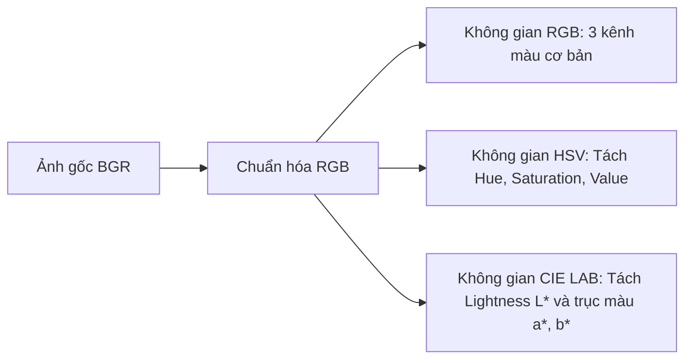
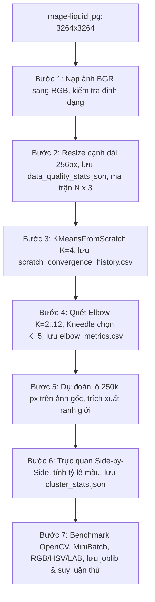

# 🎨 Bài Lab Phân Đoạn Ảnh Bằng K-Means (K-Means Image Segmentation)

Bài lab **“Practice Exercise 3 (Additional): K-Means Image Segmentation”** thực hành gom cụm màu sắc và phân đoạn ảnh bằng thuật toán **K-Means**. Mục tiêu bài học là nắm vững quy trình học máy không giám sát: từ nạp ảnh, kiểm tra chất lượng điểm ảnh, tiền xử lý ma trận dữ liệu đến tự cài đặt thuật toán thuần NumPy, so sánh với các thư viện chuẩn (Scikit-Learn, OpenCV) và tái tạo ảnh phân đoạn ở độ phân giải gốc.

> **Cách triển khai:** tự cài đặt thuật toán `KMeansFromScratch` bằng NumPy; sử dụng `sklearn.cluster.KMeans` để quét tìm số cụm bằng Elbow Method; dùng `cv2.kmeans` của OpenCV để kiểm định chéo nhãn; dùng `MiniBatchKMeans` để khảo sát đánh đổi tốc độ; trực quan hóa bằng Matplotlib và lưu trữ mô hình bằng `joblib`.
>
> **Kiểm chứng ngày 17/11/2026:** **39/39 tests pass** trên môi trường Python 3.12, bao gồm kiểm thử hợp đồng dữ liệu và kiểm thử hồi quy pipeline. Toàn bộ số liệu trong README được đối chiếu trực tiếp từ các tệp kết quả của `main.py` trong thư mục `results/metrics/`. Bốn Jupyter Notebooks là luồng thực hành tương tác độc lập; kết quả biểu đồ và bảng dữ liệu được nhúng nội bộ bên trong từng notebook mà không ghi đè vào `results/`.
>
> **Kết quả chính:** Điểm gập Elbow tự động chọn **K = 5** trên ảnh làm việc $256 \times 256$ (Silhouette đạt **0,4249** trên mẫu phân tầng RGB và **0,4552** trên CIE LAB). Mô hình tái tạo trọn vẹn toàn bộ **10.653.696 pixel** của ảnh gốc $3264 \times 3264$. Đây là kết quả lượng tử hóa màu sắc trong phạm vi bài lab thực hành, chưa bao gồm phân đoạn ngữ nghĩa theo từng đối tượng riêng biệt.

---

## 1. Mô Tả Bài Toán & Dữ Liệu Đầu Vào (Problem & Input Data)

### 1.1. Mục tiêu phân đoạn và lượng tử hóa màu

Với đầu vào là một bức ảnh màu, chương trình biểu diễn mỗi điểm ảnh như một vector 3 chiều trong không gian màu:

$$
x_i = [c_1,\, c_2,\, c_3]^\top \in \mathbb{R}^3
$$

Thuật toán K-Means gom $N$ điểm ảnh thành $K$ cụm màu đại diện. Sau khi tìm được $K$ tâm cụm màu $\mu_1, \dots, \mu_K$, mỗi điểm ảnh được thay thế bằng giá trị màu của tâm cụm gần nhất:

| Điểm ảnh gốc $x_i$ | Tâm cụm gán nhãn | Điểm ảnh sau lượng tử hóa | Ý nghĩa trực quan |
| :----------------: | :--------------: | :-----------------------: | :---------------- |
| Vector màu liên tục | $c_i \in \{0, \dots, K-1\}$ | $\hat{x}_i = \mu_{c_i}$ | Đơn giản hóa bảng màu của ảnh về đúng $K$ màu chủ đạo |

Đây là bài toán **học máy không giám sát (Unsupervised Learning)**. Dữ liệu không có nhãn ground-truth phân vùng trước. Thuật toán tự tìm cấu trúc gom cụm dựa trên độ tương đồng khoảng cách trong không gian màu.

### 1.2. Nạp dữ liệu & định dạng ảnh

Dữ liệu ảnh đầu vào được lưu tại thư mục [`data/raw/`](data/raw/). Tệp ảnh mẫu mặc định cho toàn bộ thực nghiệm là [`data/raw/image-liquid.jpg`](data/raw/image-liquid.jpg) ($3264 \times 3264$ pixel, dung lượng 2.095,23 KB).

Hàm `load_image()` trong [`src/data/loader.py`](src/data/loader.py) thực hiện:
- Đọc ảnh qua bộ đệm nhị phân `cv2.imdecode(np.fromfile(...))` để xử lý an toàn đường dẫn chứa ký tự tiếng Việt hoặc Unicode trên hệ điều hành Windows.
- Chuyển đổi hệ màu chuẩn từ `BGR` của OpenCV sang `RGB` để giữ đúng sắc độ hiển thị.
- Kiểm tra tính hợp lệ của ảnh: kích thước khác 0, đầy đủ 3 chiều `(H, W, 3)` và định dạng số nguyên không âm `uint8`.
- Xử lý ảnh 4 kênh RGBA (như [`data/raw/image-sea2.png`](data/raw/image-sea2.png)): tự động trộn kênh Alpha trên nền trắng chuẩn để đưa về đúng 3 kênh `RGB`, tránh lỗi sai lệch kích thước đầu vào.

| Tệp ảnh mẫu trong `data/raw/` | Kích thước $(H \times W \times C)$ | Tổng số điểm ảnh | Dung lượng | Vai trò trong bài thực hành |
| :---------------------------- | :--------------------------------: | ---------------: | ---------: | :-------------------------- |
| `image-liquid.jpg`            | $3264 \times 3264 \times 3$ (RGB)  |   **10.653.696** | 2.095,23 KB| Ảnh chính chạy trọn vẹn pipeline 7 bước |
| `image-sea.png`               | $3264 \times 5824 \times 3$ (RGB)  |   **19.009.536** | 4.297,77 KB| Ảnh thử nghiệm suy luận chéo (Domain Shift) |
| `image-sea1.png`              | $490 \times 735 \times 3$ (RGB)    |          360.150 |   632,93 KB| Mẫu thử nghiệm bổ sung |
| `image-sea2.png`              | $876 \times 1486 \times 4$ (RGBA)  |        1.301.736 | 2.121,50 KB| Kiểm thử xử lý tự động kênh Alpha 4 chiều |
| `image.png`                   | $505 \times 600 \times 3$ (RGB)    |          303.000 |   195,09 KB| Mẫu kiểm thử kích thước tùy biến |
| `image_copy.png`              | $365 \times 547 \times 3$ (RGB)    |          199.655 |   342,34 KB| Mẫu kiểm thử kích thước nhỏ |

### 1.3. Thống kê chất lượng ma trận điểm ảnh

Trước khi phân cụm, ma trận điểm ảnh được kiểm tra tự động qua hàm `compute_color_statistics()`. Kết quả lưu tại [`results/metrics/data_quality_stats.json`](results/metrics/data_quality_stats.json) trên ảnh làm việc $256 \times 256$ ($N = 65.536$ pixel):

| Hạng mục kiểm tra | Giá trị ghi nhận | Ý nghĩa kỹ thuật |
| :---------------- | ---------------: | :--------------- |
| Tổng số điểm ảnh làm việc ($N$) | **65.536** | Đủ lớn để đại diện phân bố màu, vừa đủ nhỏ để lặp nhanh |
| Số lượng màu RGB phân biệt | **53.450** | Dữ liệu màu phong phú (chiếm 81,56% số pixel) |
| Kiểm tra giá trị bất thường (`NaN` / `Inf`) | **0 điểm ảnh** | Dữ liệu sạch hoàn toàn, sẵn sàng cho phép toán khoảng cách |
| Độ sáng trung bình (Mean Brightness) | **132,82 ± 56,07** | Phân bố ánh sáng cân bằng, độ tương phản rõ rệt |
| Kênh **R** (Red): min / max / mean / median | 3,0 / 253,0 / **177,27** / 203,0 | Tông màu nóng chiếm đa số |
| Kênh **G** (Green): min / max / mean / median | 2,0 / 245,0 / **118,06** / 121,0 | Phân bố mức trung bình |
| Kênh **B** (Blue): min / max / mean / median | 2,0 / 247,0 / **92,18** / 83,0 | Tông màu lạnh chiếm tỷ trọng thấp hơn |

### 1.4. Thu nhỏ giữ tỷ lệ (Aspect-Ratio Resizing) & Flatten ma trận

Ảnh gốc $3264 \times 3264$ chứa hơn 10,65 triệu điểm ảnh. Nếu chạy thuật toán lặp trực tiếp trên toàn bộ ảnh gốc, mỗi vòng lặp K-Means với $K=5$ phải tính hơn 53 triệu phép đo khoảng cách Euclidean, gây lãng phí bộ nhớ và thời gian trên máy cá nhân.

Hàm `resize_image_aspect_ratio()` thu nhỏ cạnh dài tối đa về `TARGET_SIZE = 256` bằng phép nội suy diện tích `cv2.INTER_AREA`, đưa kích thước về $256 \times 256$ (giảm **99,38% số pixel tính toán** nhưng vẫn giữ nguyên cấu trúc mảng màu tổng thể). Sau đó, `flatten_pixels()` duỗi phẳng ảnh thành ma trận hai chiều $(N, 3)$ với kiểu dữ liệu `float32`.

---

## 2. Phương Pháp Tiếp Cận & Kiểm Soát Thực Nghiệm

### 2.1. Tự triển khai các thành phần cốt lõi

Bài lab tự cài đặt các module độc lập trong thư mục `src/`, không phụ thuộc vào các pipeline đóng gói sẵn:

| Nhóm chức năng | Lớp / Hàm tự triển khai | Vai trò kỹ thuật |
| :------------- | :---------------------- | :--------------- |
| Tiền xử lý | `resize_image_aspect_ratio`, `flatten_pixels` | Thu nhỏ giữ tỷ lệ khung hình và duỗi ma trận 2D |
| Chuyển đổi màu | `convert_color_space`, `convert_centroids_to_rgb` | Hỗ trợ khứ hồi BGR, RGB, HSV, CIE LAB |
| Thuật toán baseline | `KMeansFromScratch` | Cài đặt 4 bước chuẩn bằng NumPy, tự xử lý cụm rỗng |
| Huấn luyện thư viện | `SklearnKMeansTrainer`, `OpenCVKMeansTrainer` | Quét Elbow và đối chiếu nhãn với C++ OpenCV |
| Tái tạo phân đoạn | `ImageSegmenter` | Tái tạo ảnh phân đoạn và trích xuất đường biên cụm |
| Đánh giá định lượng | `compute_wcss`, `compute_silhouette` | WCSS và Silhouette Score lấy mẫu phân tầng |
| Suy luận ảnh mới | `ImageSegmentationPredictor` | Đóng gói mô hình và suy luận theo đúng hệ màu đã học |

### 2.2. Tách biệt ảnh làm việc và ảnh độ phân giải gốc

- **Giai đoạn huấn luyện:** Chỉ thực hiện trên ma trận làm việc $256 \times 256$ ($65.536$ điểm ảnh) để tìm tập $K$ tâm cụm màu tối ưu một cách nhanh chóng.
- **Giai đoạn phân đoạn độ phân giải gốc:** Khi áp dụng cho ảnh gốc $3264 \times 3264$, chương trình nạp toàn bộ $10.653.696$ điểm ảnh gốc và gán nhãn theo từng lô `chunk_size = 250.000` pixel. Cách tiếp cận này giúp giữ bộ nhớ RAM ổn định, đồng thời tạo ra bức ảnh phân đoạn sắc nét ở từng pixel gốc mà không làm nhòe cạnh như cách phóng đại nội suy thông thường.

### 2.3. Tiêu chí chọn K bằng Elbow Method

Việc chọn số cụm $K = 5$ là kết quả gợi ý hình học tự động từ thuật toán **Kneedle** (`kneed.KneeLocator`) dựa trên điểm gập giảm tốc của đường cong WCSS trên dải $K \in [2, 12]$.

Đây là tiêu chuẩn định lượng trong bài lab để cân bằng giữa độ nén WCSS và số lượng cụm màu. Con số này không phải mức phân đoạn thẩm mỹ tối ưu cho mọi trường hợp; người dùng có thể linh hoạt chỉ định $K$ khác thông qua cờ dòng lệnh `--k`.

### 2.4. Lưu ý hiện tượng lệch miền màu (Domain Shift) khi suy luận

Mô hình K-Means lưu trữ các tâm cụm màu cố định đã học từ ảnh mẫu ban đầu. Khi dùng lớp `ImageSegmentationPredictor` suy luận trên một bức ảnh mới có phân bố màu hoàn toàn khác (ví dụ dùng mô hình học từ ảnh chất lỏng cam/đỏ `image-liquid.jpg` áp dụng cho ảnh biển xanh `image-sea.png`), thuật toán sẽ đóng vai trò **áp bảng màu (Color Palette Transfer)**: toàn bộ điểm ảnh mới bị ép gán về $K$ màu cũ. Chương trình ghi nhận rõ cảnh báo kỹ thuật này trong tài liệu và log hệ thống.

---

## 3. Tiền Xử Lý & Biểu Diễn Không Gian Màu (Preprocessing & Color Spaces)

### 3.1. Chuyển đổi không gian màu RGB, HSV, CIE LAB

Mỗi không gian màu có đặc tính hình học và ý nghĩa vật lý riêng:



- **RGB:** Baseline trực tiếp theo đề bài. Ba kênh đại diện cường độ ánh sáng Đỏ, Xanh lá, Xanh dương. Khoảng cách Euclidean trong RGB chịu ảnh hưởng lớn bởi biến thiên độ sáng.
- **HSV:** Tách riêng sắc độ (Hue), độ bão hòa (Saturation) và giá trị sáng (Value). Tuy nhiên, kênh Hue mang tính chất góc tuần hoàn ($0^\circ \equiv 360^\circ$, tương ứng $0 \equiv 180$ trên OpenCV uint8). Khoảng cách Euclidean tuyến tính thông thường không phản ánh đúng khoảng cách góc trên trục Hue.
- **CIE LAB:** Được thiết kế để xấp xỉ cảm nhận thị giác của mắt người (Perceptually Uniform). Kênh $L^*$ đại diện độ sáng độc lập, kênh $a^*$ biểu thị trục Xanh lá - Đỏ, kênh $b^*$ biểu thị trục Xanh dương - Vàng.

### 3.2. Khảo sát thang đo [0..255] và kiểu dữ liệu `float32`

Trong suốt quá trình huấn luyện, ma trận pixel được giữ ở thang số thực `float32` trong khoảng $[0, 255]$:
- Phép co giãn đồng nhất cả 3 kênh với hệ số $1/255$ chỉ làm thay đổi biên độ WCSS theo tỷ lệ $255^2$, không làm thay đổi nhãn phân cụm khi dùng khoảng cách Euclidean.
- Giữ thang $[0..255]$ giúp ngưỡng dung sai dừng `tol = 1e-4` mang ý nghĩa thực tế rõ ràng: thuật toán dừng khi độ dịch chuyển của các tâm nhỏ hơn $0,0001$ đơn vị mức xám.
- Tương thích trực tiếp với chuẩn đầu vào của hàm C++ `cv2.kmeans` trong OpenCV mà không cần bước nhân chia phụ.

### 3.3. Tái tạo ảnh gốc và trích xuất ranh giới cụm

Sau khi các điểm ảnh được gán nhãn cụm, hàm `reconstruct_segmented_image()` ánh xạ nhãn $c_i$ về lại giá trị màu tâm cụm $\mu_{c_i}$ và định hình lại thành tensor 3D $(H, W, 3)$ kiểu `uint8`.

Để đánh giá ranh giới giữa các mảng màu, hàm `extract_cluster_boundaries()` sử dụng toán tử hình thái học:
- Với mỗi cụm màu, tạo mặt nạ nhị phân $M_k$.
- Thực hiện phép giãn (Dilation) bằng kernel $3 \times 3$ rồi trừ đi mặt nạ gốc để trích xuất đường biên 1 pixel.
- Hợp nhất các đường biên thành ảnh ranh giới tổng thể, lưu tại [`results/figures/cluster_boundaries.png`](results/figures/cluster_boundaries.png).

---

## 4. Phương Pháp Phân Cụm & Toán Học Cốt Lõi

### 4.1. Thuật toán `KMeansFromScratch` (Pure NumPy Baseline)

Thuật toán tự cài đặt thực hiện vòng lặp 4 bước theo đúng định dạng đề bài:

1. **Khởi tạo (Initialize):** Chọn ngẫu nhiên $K$ vector màu phân biệt từ tập dữ liệu pixel bằng hạt giống ngẫu nhiên cố định (`random_state = 42`).
2. **Gán cụm (Assign):** Với mỗi điểm ảnh $x_i$, tính khoảng cách Euclidean bình phương tới toàn bộ $K$ tâm cụm:
   $$c_i = \arg\min_{j \in \{0, \dots, K-1\}} \lVert x_i - \mu_j \rVert_2^2$$
   Khi xảy ra trường hợp hòa khoảng cách (hai tâm cụm cách đều một điểm ảnh), hàm `np.argmin` chọn tâm có chỉ số nhỏ nhất một cách nhất quán.
3. **Cập nhật tâm cụm (Update):** Tọa độ mới của tâm cụm là trung bình cộng các điểm ảnh thuộc cụm đó:
   $$\mu_j = \frac{1}{|S_j|} \sum_{x \in S_j} x$$
   **Xử lý cụm rỗng:** Nếu một cụm không nhận được bất kỳ điểm ảnh nào ($|S_j| = 0$), thuật toán tìm điểm ảnh có khoảng cách tới các tâm cụm còn lại lớn nhất để tái khởi tạo cụm rỗng, tránh phép chia cho 0.
4. **Kiểm tra dừng (Stop Criteria):** Thuật toán dừng khi độ dịch chuyển lớn nhất của các tâm cụm $\max_j \lVert \mu_j^{(t+1)} - \mu_j^{(t)} \rVert_2 \le 10^{-4}$ hoặc khi chạm ngưỡng 300 vòng lặp. Kết thúc vòng lặp, mô hình gán nhãn lại một lượt trên bộ tâm cuối cùng để đảm bảo tính nhất quán giữa nhãn, tâm cụm và WCSS.

### 4.2. `SklearnKMeansTrainer` & Quét Elbow Method

Lớp bao bọc thư viện Scikit-Learn sử dụng thuật toán khởi tạo `k-means++` giúp phân tán các tâm khởi tạo ban đầu, giảm nguy cơ rơi vào cực tiểu cục bộ kém chất lượng. Quá trình quét Elbow thực hiện trên dải $K \in [2, 12]$ với `n_init = 10` lần khởi tạo độc lập, chọn lần chạy có WCSS nhỏ nhất.

### 4.3. `OpenCVKMeansTrainer` & Căn chỉnh nhãn Hungarian

Hàm `cv2.kmeans` của OpenCV thực thi bằng ngôn ngữ C++ với cờ `cv2.KMEANS_PP_CENTERS`.

Để đối chiếu nhãn phân cụm giữa Scikit-Learn và OpenCV (do chỉ số cụm $0, 1, \dots, K-1$ có thể bị hoán vị ngẫu nhiên giữa hai thư viện), phương thức `align_cluster_labels()` sử dụng giải thuật Hungarian (`scipy.optimize.linear_sum_assignment`) trên ma trận nhầm lẫn (contingency matrix) để tìm ra phép ánh xạ nhãn 1-1 tối ưu nhất trước khi tính toán tỷ lệ trùng khớp nhãn.

### 4.4. `MiniBatchKMeansTrainer` & Phân tích đánh đổi tốc độ

Thay vì tính toán trên toàn bộ $N$ điểm ảnh ở mỗi vòng lặp, Mini-Batch K-Means lấy ngẫu nhiên các lô nhỏ có kích thước `batch_size` để cập nhật tọa độ tâm cụm bằng trung bình trượt có trọng số. Thử nghiệm khảo sát 5 mức kích thước lô: `256`, `512`, `1.024`, `2.048` và `4.096`.

---

## 5. Quy Trình Thực Thi (Workflow 7 Giai Đoạn)

Quy trình xử lý hoàn chỉnh của bài lab được điều phối trong [`main.py`](main.py):



| Giai đoạn trong `main.py` | Hàm điều phối | Tệp kết quả sinh ra |
| :------------------------ | :------------ | :------------------ |
| Bước 1: Nạp ảnh & Hệ màu | `step_1_load_and_color_spaces()` | `results/figures/color_spaces_comparison.png` |
| Bước 2: Tiền xử lý & Ma trận | `step_2_preprocess_and_flatten()` | `results/metrics/data_quality_stats.json` |
| Bước 3: K-Means thuần từ đầu | `step_3_kmeans_from_scratch()` | `scratch_convergence_history.csv`, `kmeans_convergence.png`, `scratch_baseline_side_by_side.png` |
| Bước 4: Khảo sát Elbow & Chọn K | `step_4_elbow_method_optimal_k()` | `elbow_metrics.csv`, `elbow_method.png`, `k_evolution_grid.png` |
| Bước 5: Phân đoạn ảnh gốc | `step_5_segment_and_reconstruct()` | `results/figures/cluster_boundaries.png` |
| Bước 6: Trực quan hóa & Thống kê | `step_6_visualize_side_by_side()` | `cluster_stats.json`, `final_segmentation_side_by_side.png`, `cluster_distribution.png` |
| Bước 7: Kiểm định chéo & Lưu | `step_7_advanced_benchmarks_and_save()` | `opencv_comparison.json`, `minibatch_comparison.csv`, `color_space_comparison.json`, `kmeans_segmentation.joblib`, `inference_preview/` |

---

## 6. Cấu Trúc Thư Mục Bài Lab (Folder Structure)

```text
Lab_3.2_ADDITIONAL_K-MEANS_IMAGE_SEGMENTATION/
├── main.py                                      # Tệp điều phối chính chạy toàn bộ 7 bước
├── requirements.txt                             # Khai báo các thư viện phụ thuộc
├── README.md                                    # Hướng dẫn và báo cáo tóm tắt bài lab
├── data/
│   ├── raw/                                     # Dữ liệu ảnh mẫu đầu vào (.jpg, .png)
│   │   ├── image-liquid.jpg                     # Ảnh mẫu chính (3264x3264 px)
│   │   ├── image-sea.png                        # Ảnh thử nghiệm suy luận chéo
│   │   └── image-sea2.png                       # Ảnh 4 kênh RGBA
│   └── processed/                               # Chứa ảnh tạm và .gitkeep
├── docs/
│   ├── Practice Exercise 3.2.pdf                # Đề bài thực hành gốc môn học
│   ├── Algorithms/                              # Tài liệu phân tích thiết kế ban đầu của 4 thuật toán
│   │   ├── design.md
│   │   ├── kmeans_from_scratch.md
│   │   ├── kmeans_sklearn.md
│   │   ├── kmeans_opencv.md
│   │   └── minibatch_kmeans.md
│   └── reports/                                 # Báo cáo thực nghiệm học thuật
│       ├── lab_3_2_experiment_report.html       # Bản báo cáo HTML đầy đủ công thức và biểu đồ
│       └── Báo cáo bài lab – Phân đoạn ảnh...pdf# Bản in PDF phục vụ lưu trữ/nộp bài
├── notebooks/                                   # 4 Jupyter Notebooks nhúng biểu đồ và bảng dữ liệu nội bộ
│   ├── 01_image_loading_and_preprocessing.ipynb
│   ├── 02_kmeans_scratch_and_convergence.ipynb
│   ├── 03_elbow_and_sklearn_segmentation.ipynb
│   └── 04_advanced_comparisons_and_metrics.ipynb
├── results/                                     # Kết quả xuất ra từ main.py
│   ├── figures/                                 # 11 biểu đồ trực quan hóa (.png)
│   │   └── inference_preview/                   # Ảnh trực quan suy luận chéo trên ảnh mới
│   ├── metrics/                                 # Bảng số liệu thực nghiệm (.json, .csv)
│   └── saved_models/                            # Mô hình K-Means và metadata đã lưu (.joblib)
├── src/                                         # Mã nguồn chính của bài lab
│   ├── config.py                                # Cấu hình tham số, đường dẫn và seed
│   ├── data/
│   │   ├── loader.py                            # Nạp ảnh an toàn, kiểm tra định dạng, xử lý Alpha
│   │   └── preprocessing.py                     # Resize giữ tỷ lệ, flatten, quy đổi hệ màu
│   ├── features/
│   │   └── color_features.py                    # Trích xuất phân bố màu, gán nhãn tên màu
│   ├── models/
│   │   ├── kmeans_scratch.py                    # Cài đặt KMeansFromScratch thuần NumPy
│   │   ├── kmeans_sklearn.py                    # Scikit-Learn KMeans và quét tìm Elbow
│   │   ├── kmeans_opencv.py                     # OpenCV cv2.kmeans và thuật toán Hungarian
│   │   ├── minibatch_kmeans.py                  # Đánh giá tốc độ và WCSS của MiniBatch
│   │   └── persistence.py                       # Đóng gói và nạp mô hình qua joblib
│   ├── segmentation/
│   │   └── segmenter.py                         # Tái tạo ảnh phân đoạn và ranh giới cụm
│   ├── evaluation/
│   │   ├── metrics.py                           # WCSS, Silhouette phân tầng, ARI, NMI
│   │   └── visualization.py                     # Vẽ ảnh song song, đường cong Elbow, lưới tiến hóa
│   ├── deployment/
│   │   └── predictor.py                         # Lớp ImageSegmentationPredictor suy luận ảnh mới
│   └── utils/
│       └── logger.py                            # Logging định dạng chuẩn ra console
└── tests/                                       # Bộ kiểm thử tự động (39 unit tests)
    ├── test_data.py
    ├── test_models.py
    ├── test_segmentation.py
    ├── test_evaluation.py
    └── test_pipeline_regressions.py
```

---

## 7. Ánh Xạ Yêu Cầu Đề Bài Với Phần Triển Khai

| Yêu cầu trong đề bài (`Practice Exercise 3.2`) | Module triển khai | Cách thực hiện cụ thể trong mã nguồn |
| :--------------------------------------------- | :---------------- | :----------------------------------- |
| **Task 1: Load the Image** | `src/data/loader.py`, `src/data/preprocessing.py` | Đọc ảnh qua `cv2.imdecode`, chuẩn hóa về RGB 3 kênh, hỗ trợ chuyển đổi sang HSV và CIE LAB. |
| **Task 2: Preprocess the Image** | `src/data/preprocessing.py` | Thu nhỏ giữ tỷ lệ về cạnh dài tối đa 256 pixel bằng `cv2.INTER_AREA`; duỗi phẳng ảnh $H \times W \times 3$ thành ma trận $N \times 3$ kiểu `float32`. |
| **Task 3: Apply K-Means Clustering** | `src/models/kmeans_scratch.py`, `src/models/kmeans_sklearn.py` | Tự cài đặt 4 bước lặp (Initialize, Assign, Update, Repeat) bằng NumPy; dùng Scikit-Learn quét tìm $K$ tối ưu qua Elbow Method. |
| **Task 4: Segment the Image** | `src/segmentation/segmenter.py` | Thay thế mỗi pixel bằng vector màu của tâm cụm tương ứng; khôi phục kích thước làm việc và tái tạo trên toàn bộ 10,65 triệu pixel ảnh gốc. |
| **Task 5: Visualize the Results** | `src/evaluation/visualization.py`, `src/features/color_features.py` | Vẽ ảnh gốc và ảnh phân đoạn cạnh nhau (Side-by-Side); tính tỷ lệ % diện tích từng cụm và vẽ biểu đồ thanh ngang phân bố màu. |
| **Mở rộng nâng cao (Additional Experiments)** | `src/models/kmeans_opencv.py`, `src/models/minibatch_kmeans.py`, `src/deployment/predictor.py` | Kiểm định chéo với OpenCV C++, khảo sát đánh đổi thời gian của Mini-Batch, so sánh 3 hệ màu và đóng gói suy luận sang ảnh mới. |

---

## 8. Kết Quả Thực Nghiệm Tham Chiếu (Evaluation Results)

Toàn bộ số liệu dưới đây được trích xuất trực tiếp từ các tệp kết quả trong `results/metrics/` sau khi chạy `main.py` trên ảnh `image-liquid.jpg` với hạt giống ngẫu nhiên cố định `seed = 42`.

### 8.1. Baseline K = 4 và đường cong hội tụ (`KMeansFromScratch`)

Mô hình tự viết bằng NumPy chạy với $K = 4$, ngưỡng dung sai `tol = 1e-4`, giới hạn 300 vòng lặp:
- Thuật toán đạt điều kiện hội tụ ở vòng lặp thứ **26** (độ dịch chuyển tâm cụm đạt `0,0`, tỷ lệ đổi nhãn `0,0%`).
- Quán tính cuối cùng: **WCSS = 156.330.549,40**.
- So sánh đối chứng: Mô hình `sklearn.cluster.KMeans` ở cùng cấu hình $K = 4$ cho **WCSS = 156.334.928,00** (độ lệch tương đối dưới **0,003%**), cho thấy thuật toán tự cài đặt hội tụ sát với nghiệm của thư viện.

| Vòng lặp tiêu biểu | WCSS (Inertia) | Độ dịch tâm lớn nhất ($\Delta \mu$) | Tỷ lệ điểm ảnh đổi nhãn |
| :----------------: | -------------: | ----------------------------------: | ----------------------: |
| 1 | 249.116.012,00 | 55,4833 | 100,00% |
| 2 | 171.551.132,78 | 21,8476 | 9,58% |
| 5 | 156.696.038,39 | 1,7150 | 1,30% |
| 10 | 156.337.410,58 | 0,2744 | 0,18% |
| 15 | 156.330.820,90 | 0,0310 | 0,02% |
| 20 | 156.330.565,23 | 0,0102 | 0,0061% |
| **26 (Hội tụ)** | **156.330.549,40** | **0,0000** | **0,00%** |

### 8.2. Khảo sát Elbow Method và chọn số cụm tối ưu

Khảo sát quét trên dải $K \in [2, 12]$ bằng `SklearnKMeansTrainer` (`elbow_metrics.csv`):

| Số cụm ($K$) | Inertia (WCSS) | Số vòng lặp hội tụ | Thời gian fit (giây) | Nhận xét hình học |
| :----------: | -------------: | :----------------: | :------------------: | :---------------- |
| 2 | 334.192.736,0 | 10 | 0,1880 | Gom cụm quá thô, mất chi tiết mảng màu |
| 3 | 232.992.992,0 | 6 | 0,2102 | WCSS giảm mạnh |
| 4 | 156.334.928,0 | 18 | 0,2989 | Mốc baseline |
| **5** | **121.024.704,0** | **7** | **0,3683** | **Điểm khuỷu tay (Elbow) do Kneedle lựa chọn** |
| 6 | 104.840.664,0 | 10 | 0,5410 | Tốc độ giảm WCSS chậm dần rõ rệt |
| 7 | 90.721.552,0 | 23 | 0,6460 | Bắt đầu chia nhỏ các mảng màu chuyển tiếp |
| 8 | 78.616.960,0 | 51 | 0,7688 | Số vòng lặp tăng cao |
| 9 | 70.459.792,0 | 32 | 0,6439 | |
| 10 | 64.329.860,0 | 37 | 0,7768 | |
| 11 | 58.793.260,0 | 31 | 1,0022 | |
| 12 | 54.090.324,0 | 37 | 0,8931 | Đường cong gần như đi ngang |

Tại **$K = 5$**, mức giảm WCSS so với $K=4$ là hơn 35,31 triệu đơn vị, trong khi sang $K=6$ mức giảm chỉ còn khoảng 16,18 triệu đơn vị. Mô hình tại $K=5$ đạt **Silhouette Score = 0,4249** trên mẫu phân tầng RGB.

### 8.3. Bảng phân bố 5 cụm màu ở độ phân giải gốc ($3264 	imes 3264$)

Khi áp dụng mô hình đã huấn luyện lên toàn bộ 10.653.696 điểm ảnh của ảnh gốc (`cluster_stats.json`):

| Hạng | Cụm | Tên màu nhận diện | Mã HEX | Tọa độ tâm RGB (`uint8`) | Số lượng điểm ảnh | Tỷ lệ diện tích (%) |
| :--: | :-: | :---------------- | :----: | :----------------------: | ----------------: | ------------------: |
| 1 | `#0` | Cam rực (Orange) | `#D17043` | `[209, 112, 67]` | 3.139.461 | **29,47%** |
| 2 | `#2` | Cam vàng (Yellow-Orange) | `#EDBD5D` | `[237, 189, 93]` | 2.948.244 | **27,67%** |
| 3 | `#1` | Đỏ mận (Magenta-Red) | `#88395A` | `[136, 57, 90]` | 1.844.562 | **17,31%** |
| 4 | `#4` | Tím than (Dark-Violet) | `#28193E` | `[40, 25, 62]` | 1.425.227 | **13,38%** |
| 5 | `#3` | Xám nhạt (Light Gray) | `#ACA2BE` | `[172, 162, 190]` | 1.296.202 | **12,17%** |
| **Tổng** | | **5 màu đại diện** | | | **10.653.696** | **100,00%** |

Hai cụm màu tông ấm (`#0` và `#2`) chiếm tổng cộng **57,14%** diện tích bức ảnh, phản ánh chính xác phân bố màu chất lỏng chủ đạo của đối tượng trong ảnh.

### 8.4. Kiểm định chéo: Scikit-Learn vs OpenCV (`cv2.kmeans`)

Đối chiếu tại $K = 5$ trên cùng tập dữ liệu làm việc 65.536 điểm ảnh (`opencv_comparison.json`):
- **Sai khác WCSS / Compactness:** Scikit-Learn đạt `121.024.704,00` so với OpenCV đạt `121.043.674,52` (độ chênh lệch tương đối chỉ **0,0157%**).
- **Mức độ trùng khớp nhãn:** Sau khi tìm phép ánh xạ nhãn tối ưu bằng thuật toán Hungarian (`{0: 0, 1: 4, 2: 3, 3: 1, 4: 2}`), hai thuật toán cho kết quả trùng khớp nhãn trên **99,36% điểm ảnh** (`ARI = 0,9834`, `NMI = 0,9743`).
- **Thời gian thực thi:** OpenCV C++ hoàn thành trong **0,0942 giây**, nhanh gấp **2,85 lần** so với Scikit-Learn (**0,2684 giây**).

### 8.5. Khảo sát đánh đổi với Mini-Batch K-Means

Thực nghiệm đo lường sự đánh đổi giữa thời gian huấn luyện và độ tổn thất WCSS trên 65.536 điểm ảnh (`minibatch_comparison.csv`):

| Cấu hình | Kích thước lô (Batch) | Thời gian fit (giây) | Tốc độ tương đối (Speedup) | Inertia (WCSS) | Độ tăng WCSS (%) | Chỉ số ARI | Chỉ số NMI |
| :------- | --------------------: | -------------------: | -------------------------: | -------------: | ---------------: | ---------: | ---------: |
| **Full KMeans** | 65.536 (toàn bộ) | 0,3304 | 1,00x | 121.024.704,0 | +0,00% | 1,0000 | 1,0000 |
| MiniBatch | 256 | 0,7225 | 0,46x | 121.054.752,0 | +0,02% | 0,9938 | 0,9869 |
| MiniBatch | 512 | 0,6831 | 0,48x | 121.602.440,0 | +0,48% | 0,9300 | 0,9148 |
| MiniBatch | 1.024 | 0,5978 | 0,55x | 121.342.200,0 | +0,26% | 0,9100 | 0,9089 |
| MiniBatch | 2.048 | 0,1524 | **2,17x** | 121.410.992,0 | +0,32% | 0,9085 | 0,9093 |
| MiniBatch | 4.096 | 0,1397 | **2,37x** | 121.542.400,0 | +0,43% | 0,8821 | 0,8866 |

> **Nhận xét kỹ thuật:** Khi số lượng điểm ảnh ở mức trung bình ($N = 65.536$), các kích thước lô nhỏ từ 256 đến 1.024 thực tế lại chậm hơn Full KMeans do chi phí lặp lại các vòng lấy mẫu Python và cập nhật từng bước. Mini-Batch chỉ bắt đầu thể hiện rõ ưu thế tăng tốc (nhanh gấp **2,17x – 2,37x**) khi `batch_size >= 2048`, trong khi mức suy giảm chất lượng WCSS vẫn được kiểm soát rất tốt (tăng dưới **0,5%**).

### 8.6. So sánh 3 không gian màu (RGB vs HSV vs CIE LAB)

Thực nghiệm phân cụm tại $K = 5$ trên 3 hệ màu (`color_space_comparison.json`), đo trên mẫu phân tầng 5.000 pixel:

| Không gian màu | Silhouette Score | Thời gian fit (giây) | Phân tích đặc tính thực nghiệm |
| :------------- | :--------------: | :------------------: | :----------------------------- |
| **RGB** | 0,4249 | 0,2684 | Baseline cơ bản, màu sắc phân đoạn cân đối |
| **HSV** | 0,4172 | 0,3240 | Silhouette thấp nhất do trục Hue mang tính góc tuần hoàn nhưng bị xử lý tuyến tính bởi khoảng cách Euclidean |
| **CIE LAB** | **0,4552** | 0,2985 | **Silhouette cao nhất**; cấu trúc tách biệt độ sáng $L^*$ và trục màu $(a^*, b^*)$ gần với cảm nhận thị giác người hơn |

---

## 9. Hướng Dẫn Cài Đặt & Khởi Chạy

### 9.1. Chuẩn bị môi trường

Bài lab yêu cầu **Python 3.10 trở lên** (đã kiểm chứng ổn định trên Python 3.12). Khuyến nghị thiết lập môi trường ảo:

```powershell
# Tạo môi trường ảo
python -m venv .venv

# Kích hoạt môi trường (Windows PowerShell)
.\.venv\Scripts\Activate.ps1

# Cài đặt các thư viện phụ thuộc
pip install -r requirements.txt
```

### 9.2. Chạy pipeline tham chiếu chính (`main.py`)

Chạy pipeline mặc định trên ảnh `image-liquid.jpg` với hệ màu RGB và tự động chọn $K$ qua Elbow:

```powershell
python main.py
```

Các cờ tùy biến tham số dòng lệnh (CLI):

```powershell
# 1. Chỉ định tệp ảnh đầu vào khác
python main.py --image data/raw/image-sea.png

# 2. Cố định số cụm K mong muốn (ví dụ K = 6)
python main.py --k 6

# 3. Thay đổi không gian màu phân cụm (RGB, HSV hoặc LAB)
python main.py --color-space LAB

# 4. Điều chỉnh kích thước thu nhỏ khi fit (ví dụ tối đa 128 pixel)
python main.py --target-size 128

# 5. Bỏ qua bước benchmark mở rộng đa hệ màu để chạy nhanh
python main.py --skip-color-space-benchmark
```

### 9.3. Chạy bộ kiểm thử tự động

Chạy toàn bộ 39 unit tests để xác minh tính toàn vẹn của mã nguồn:

```powershell
python -m unittest discover tests -v
```

### 9.4. Dự đoán phân đoạn ảnh mới bằng Python

Sử dụng lớp `ImageSegmentationPredictor` trong mã nguồn Python của bạn:

```python
from pathlib import Path
from src.deployment.predictor import ImageSegmentationPredictor

# Khởi tạo dịch vụ từ tệp mô hình đã lưu
predictor = ImageSegmentationPredictor(
    model_path=Path("results/saved_models/kmeans_segmentation.joblib")
)

# Thực hiện phân đoạn trên một bức ảnh mới
result = predictor.predict(
    image_path=Path("data/raw/image-sea.png"),
    output_dir=Path("results/figures/inference_preview"),
    target_size=256,
    return_original_size=True,
)

print(f"Ảnh đầu vào: {result['original_metadata']['file_name']}")
print(f"Kích thước gốc: {result['original_metadata']['shape']}")
print(f"Số cụm màu đã học: {result['k']}")
print(f"Đường dẫn ảnh phân đoạn: {result['output_paths']['segmented_original']}")
```

### 9.5. Thay đổi cấu hình thực nghiệm

Mọi cấu hình mặc định được quản lý tập trung tại [`src/config.py`](src/config.py):
- `TARGET_SIZE = 256`: Kích thước cạnh dài tối đa khi resize ảnh.
- `BASELINE_K = 4`: Số cụm khởi tạo ban đầu cho `KMeansFromScratch`.
- `K_SEARCH_MIN = 2`, `K_SEARCH_MAX = 12`: Dải quét tìm số cụm của Elbow Method.
- `MAX_ITER = 300`: Số vòng lặp tối đa của K-Means.
- `TOLERANCE = 1e-4`: Ngưỡng dung sai kiểm tra dừng hội tụ.
- `RANDOM_SEED = 42`: Hạt giống ngẫu nhiên đảm bảo tính tái lập.

---

## 10. Bốn Jupyter Notebooks & Quy Tắc Tái Lập

Bên cạnh luồng chạy `main.py`, bài lab cung cấp 4 sổ tay Jupyter tương tác tại thư mục [`notebooks/`](notebooks/) phục vụ việc học tập và quan sát từng bước:

| Thứ tự | Tệp Notebook | Nội dung chi tiết |
| :----: | :----------- | :---------------- |
| 01 | [`01_image_loading_and_preprocessing.ipynb`](notebooks/01_image_loading_and_preprocessing.ipynb) | Nạp ảnh, chuyển đổi RGB/HSV/LAB, kiểm tra chất lượng kênh màu và làm phẳng ma trận pixel. |
| 02 | [`02_kmeans_scratch_and_convergence.ipynb`](notebooks/02_kmeans_scratch_and_convergence.ipynb) | Huấn luyện `KMeansFromScratch` ($K=4$), trực quan hóa đường cong giảm WCSS qua từng vòng lặp. |
| 03 | [`03_elbow_and_sklearn_segmentation.ipynb`](notebooks/03_elbow_and_sklearn_segmentation.ipynb) | Quét dải $K \in [2, 12]$, vẽ đồ thị Elbow, lưới ảnh tiến hóa và tái tạo ảnh phân đoạn gốc $3264 	imes 3264$. |
| 04 | [`04_advanced_comparisons_and_metrics.ipynb`](notebooks/04_advanced_comparisons_and_metrics.ipynb) | Đối chiếu Scikit-Learn với OpenCV, benchmark tốc độ Mini-Batch, so sánh 3 hệ màu và thử nghiệm suy luận chéo. |

> **Nguyên tắc cô lập kết quả:** Cả 4 notebook đều được thiết lập để tự sinh và nhúng trực tiếp biểu đồ PNG base64 và bảng dữ liệu HTML ngay bên trong cấu trúc cell output của notebook. Các notebook không ghi đè vào thư mục `results/` của `main.py`, bảo đảm luồng báo cáo chính luôn nguyên vẹn và độc lập.

---

## 11. Các Tệp Kết Quả & Báo Cáo Thực Nghiệm

### 11.1. Bảng danh mục tệp kết quả sinh ra từ `main.py`

| Thư mục lưu trữ | Tên tệp | Nội dung chi tiết |
| :-------------- | :------ | :---------------- |
| `results/metrics/` | `data_quality_stats.json` | Thống kê min/max, trung bình, trung vị, IQR các kênh màu |
| `results/metrics/` | `scratch_convergence_history.csv` | Lịch sử WCSS và độ dịch tâm qua 26 vòng lặp của NumPy baseline |
| `results/metrics/` | `elbow_metrics.csv` | Bảng Inertia và thời gian chạy từ $K=2$ đến $K=12$ |
| `results/metrics/` | `cluster_stats.json` | Tỷ lệ diện tích %, mã HEX và tọa độ RGB của 5 cụm màu |
| `results/metrics/` | `opencv_comparison.json` | Bảng đối chiếu WCSS, ARI, NMI và thời gian với OpenCV C++ |
| `results/metrics/` | `minibatch_comparison.csv` | Số liệu benchmark tốc độ và sai số của Mini-Batch |
| `results/metrics/` | `color_space_comparison.json` | So sánh Silhouette Score giữa RGB, HSV và CIE LAB |
| `results/figures/` | `final_segmentation_side_by_side.png` | Ảnh gốc cạnh ảnh phân đoạn ở kích thước gốc $3264 	imes 3264$ |
| `results/figures/` | `cluster_distribution.png` | Biểu đồ thanh ngang tỷ lệ % diện tích các cụm màu theo mã HEX |
| `results/figures/` | `cluster_boundaries.png` | Mặt nạ các đường ranh giới phân chia vùng màu |
| `results/figures/` | `elbow_method.png` | Đồ thị đường cong WCSS xác định điểm khuỷu tay |
| `results/figures/` | `kmeans_convergence.png` | Đồ thị diễn biến giảm WCSS của thuật toán tự viết |
| `results/figures/` | `k_evolution_grid.png` | Lưới ảnh so sánh mức độ đơn giản hóa màu theo $K$ tăng dần |
| `results/figures/` | `minibatch_visual_comparison.png` | Ảnh so sánh trực quan giữa Full KMeans và Mini-Batch |
| `results/figures/` | `color_space_segmentation_comparison.png` | Ảnh so sánh phân đoạn khi fit trên RGB, HSV và CIE LAB |
| `results/saved_models/` | `kmeans_segmentation.joblib` | Gói mô hình đã huấn luyện kèm metadata cấu hình |

### 11.2. Báo cáo thực nghiệm chi tiết

Bên cạnh README, bài lab có tài liệu báo cáo chi tiết tại:
- **Bản HTML tương tác:** [`docs/reports/lab_3_2_experiment_report.html`](docs/reports/lab_3_2_experiment_report.html) (tích hợp mục lục 2 cột, công thức MathJax, sơ đồ khối và toàn bộ 11 hình ảnh kết quả).
- **Bản in PDF độc lập:** [`docs/reports/Báo cáo bài lab – Phân đoạn ảnh và lượng tử hóa màu bằng thuật toán K-Means.pdf`](docs/reports/Báo cáo bài lab – Phân đoạn ảnh và lượng tử hóa màu bằng thuật toán K-Means.pdf) (dung lượng 12,20 MB, tự chứa toàn bộ biểu đồ phục vụ việc in ấn hoặc nộp bài).

---

## 12. Giới Hạn Hiện Tại & Hướng Phát Triển

| Giới hạn đã biết | Nguyên nhân kỹ thuật | Hướng khắc phục phù hợp |
| :--------------- | :------------------- | :---------------------- |
| **Bỏ qua thông tin không gian $(x, y)$** | K-Means chỉ tính khoảng cách trên các kênh màu, xem mỗi pixel là điểm độc lập | Ghép thêm tọa độ chuẩn hóa $[x, y]$ vào vector đặc trưng (vector 5 chiều $[R, G, B, x, y]$) hoặc áp dụng thuật toán phân đoạn Superpixel (SLIC) |
| **Giả định cụm đẳng hướng (cụm cầu)** | Khoảng cách Euclidean mặc định các cụm màu có dạng hình cầu trong không gian | Sử dụng mô hình hỗn hợp Gauss (Gaussian Mixture Models - GMM) với ma trận hiệp phương sai đầy đủ để biểu diễn các cụm màu dẹt |
| **Nhạy cảm với khởi tạo ngẫu nhiên** | Thuật toán có thể rơi vào cực tiểu cục bộ nếu các tâm ban đầu bốc trúng điểm ngoại lai | Luôn sử dụng phương pháp khởi tạo `k-means++` và lặp lại nhiều lần (`n_init >= 10`) |
| **Điểm khuỷu tay mang tính hình học** | Thuật toán Kneedle dựa trên độ cong WCSS, chưa phản ánh ngữ nghĩa đối tượng trong ảnh | Kết hợp thêm các chỉ số chất lượng cảm nhận thị giác (PSNR, SSIM) hoặc dựa vào yêu cầu nén màu thực tế của ứng dụng |
| **Lệch miền dữ liệu (Domain Shift) khi suy luận** | Tâm màu cố định của ảnh nguồn không bao quát được bảng màu của ảnh đích mới | Cần huấn luyện lại mô hình riêng trên từng ảnh mới, hoặc chuyển sang các kiến trúc mạng nơ-ron học sâu phân đoạn ngữ nghĩa có giám sát (U-Net, Mask R-CNN) |

---

*Báo cáo bài thực hành môn Học máy — Cập nhật và kiểm chứng ngày 17/11/2026.*
