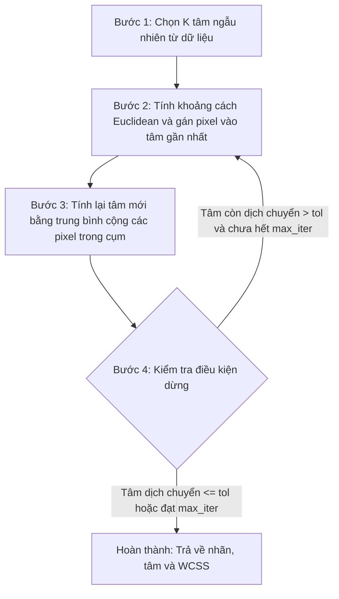

# Thiết kế thuật toán: K-Means tự code từ đầu (K-Means from Scratch)

---

## 1. Mục đích

- Hiện thực hóa yêu cầu **Bước 3: Apply K-Means Clustering** trong đề bài theo đúng 4 bước được mô tả:
  - *Initialize K random centroids, each representing the mean color of a cluster:* Khởi tạo K tâm màu ngẫu nhiên.
  - *Assign each pixel to the nearest centroid based on Euclidean distance:* Gán từng điểm ảnh vào tâm cụm gần nhất bằng khoảng cách Euclidean.
  - *Update the centroids as the mean of the pixels assigned to each cluster:* Cập nhật lại tọa độ tâm cụm bằng trung bình cộng các điểm ảnh trong cụm.
  - *Repeat the assignment and update steps until convergence:* Lặp lại bước gán và cập nhật cho tới khi hội tụ.
- **Lựa chọn triển khai của nhóm:** Tự lập trình trực tiếp 4 bước này bằng thư viện `NumPy` để hiểu rõ cơ chế tính toán chi tiết của thuật toán K-Means theo đúng từng gạch đầu dòng mà đề bài đã nêu.

---

## 2. Trạng thái thiết kế (Status)

- **Trạng thái:** `Bản thiết kế ban đầu (Pending Implementation)`
- **Tiến độ code:** Mới có khung hàm mẫu trong `src/models/kmeans_scratch.py`, chưa viết nội dung xử lý, chưa chạy thử trên ảnh thật.

---

## 3. Dữ liệu sử dụng (Data used)

- **Nguồn dữ liệu:** Ma trận điểm ảnh nhận từ bước tiền xử lý ảnh (`src/data/preprocessing.py`).
- **Đặc điểm dữ liệu:**
  - Dạng mảng 2 chiều gồm các hàng, mỗi hàng là một điểm ảnh với 3 kênh màu (RGB).
  - Kiểu dữ liệu: Số thực `float32`.
  - Thang giá trị màu: Nằm trong đoạn `[0.0, 255.0]`.
  - Kích thước ma trận: `(N, 3)` với $N = h \times w$ ($h, w$ là chiều cao và chiều rộng của ảnh sau khi resize nhỏ lại để máy chạy nhanh).

---

## 4. Đầu vào (Input)

Thuật toán cần nhận các tham số sau khi khởi tạo và huấn luyện:

| Tham số               | Kiểu dữ liệu | Ý nghĩa                                                                                                                                 | Giá trị dự kiến ban đầu |
| :--------------------- | :-------------- | :---------------------------------------------------------------------------------------------------------------------------------------- | :---------------------------- |
| `X`                  | `np.ndarray`  | Ma trận điểm ảnh cần phân cụm, kích thước `(N, 3)`.                                                                           | Lấy từ ảnh sau resize      |
| `n_clusters` ($K$) | `int`         | Số lượng cụm màu muốn gom.                                                                                                          | Thử trước với $K = 4$   |
| `max_iter`           | `int`         | Số vòng lặp tối đa đề phòng thuật toán không chịu dừng.                                                                      | $300$ vòng                 |
| `tol`                | `float`       | Ngưỡng sai số dịch chuyển tâm. Nếu tâm dịch chuyển ít hơn số này thì coi như đã hội tụ và dừng.                     | $1e-4$                      |
| `random_state`       | `int`         | Số seed cố định để việc chọn tâm ngẫu nhiên lúc đầu luôn ra giống nhau, cả nhóm chạy máy ai cũng ra cùng kết quả. | $42$                        |

---

## 5. Đầu ra (Output)

Sau khi chạy xong vòng lặp, thuật toán sẽ trả về các kết quả sau:

- **`centroids` (Tọa độ tâm cụm):** Mảng kích thước `(K, 3)`, lưu màu RGB trung bình của $K$ cụm tìm được.
- **`labels_` (Nhãn cụm của từng điểm ảnh):** Mảng 1 chiều kích thước `(N,)`, mỗi phần tử là một số nguyên từ $0$ đến $K-1$, cho biết điểm ảnh thứ $i$ thuộc về cụm nào.
- **`inertia_` (Quán tính WCSS):** Một số thực duy nhất, là tổng bình phương khoảng cách từ tất cả các điểm ảnh tới tâm cụm mà nó thuộc về. Dùng để xem các điểm ảnh có gom chặt quanh tâm hay không.
- **`n_iter_`:** Số vòng lặp thực tế mà thuật toán đã chạy trước khi dừng.
- **`history_`:** Một danh sách lưu lại thông tin qua từng vòng lặp (vòng lặp số mấy, giá trị WCSS lúc đó, tâm dịch chuyển bao nhiêu) để sau này vẽ biểu đồ hội tụ.

---

## 6. Cách thuật toán hoạt động (How it works)

Thuật toán gồm 4 bước bám sát yêu cầu đề bài:

### Bước 1: Khởi tạo tâm cụm ban đầu (`_init_centroids`)

Dùng seed ngẫu nhiên (`random_state=42`), lấy ngẫu nhiên $K$ hàng trong ma trận điểm ảnh $X$ làm $K$ tâm màu ban đầu (lấy không trùng lặp):

$$
\mu_1, \mu_2, \dots, \mu_K \in \mathbb{R}^3
$$

### Bước 2: Gán điểm ảnh vào cụm gần nhất (`_assign_clusters`)

Với mỗi điểm ảnh $x_i = [R_i, G_i, B_i]$, tính khoảng cách bình phương Euclidean tới từng tâm cụm $\mu_j$:

$$
d(x_i, \mu_j)^2 = (R_i - \mu_{j,R})^2 + (G_i - \mu_{j,G})^2 + (B_i - \mu_{j,B})^2
$$

Điểm ảnh $x_i$ nhận nhãn $c_i$ của tâm có khoảng cách gần nhất:

$$
c_i = \arg\min_{j \in \{0, \dots, K-1\}} d(x_i, \mu_j)^2
$$

Nếu có hai tâm có khoảng cách bằng nhau, quy ước chọn chỉ số nhỏ hơn để kết quả luôn nhất quán.

Tổng quán tính $\text{WCSS}$ tại vòng lặp hiện tại được tính bằng:

$$
\text{WCSS} = \sum_{i=1}^{N} d(x_i, \mu_{c_i})^2
$$

### Bước 3: Cập nhật lại tâm cụm mới (`_update_centroids`)

Với mỗi cụm $j \in \{0, \dots, K-1\}$, gom tập hợp các điểm ảnh $S_j$ đang có nhãn bằng $j$. Nếu cụm có chứa điểm ảnh, tâm mới là trung bình cộng các màu trong cụm:

$$
\mu_j^{(\text{new})} = \frac{1}{|S_j|} \sum_{x \in S_j} x
$$

Nếu cụm bị rỗng ($|S_j| = 0$, không có điểm ảnh nào nhận tâm này): Xử lý bằng cách gán lại tâm đó bằng điểm ảnh đang ở xa các tâm còn lại nhất để tránh bị lỗi chia cho 0.

### Bước 4: Kiểm tra điều kiện dừng và lặp lại (`fit`)

Tính độ dịch chuyển lớn nhất của các tâm cụm so với vòng trước:

$$
\text{shift} = \max_{j} \|\mu_j^{(\text{new})} - \mu_j^{(\text{old})}\|
$$

Thuật toán sẽ dừng khi gặp một trong hai trường hợp:
1. Hội tụ thành công: $\text{shift} \le tol$ (tâm hầu như không dịch chuyển nữa).
2. Hết số vòng lặp: Số vòng chạy đạt tới `max_iter` (300 vòng).
- Trước khi kết thúc hàm `fit`, chạy lại một lần gán nhãn cuối cùng bằng bộ tâm mới nhất để nhãn, tâm và giá trị WCSS khớp nhau hoàn toàn.

---

## 7. Cách đánh giá kết quả (Metrics evaluation)

Vì đây là bài toán gom cụm không có nhãn đúng trước (unsupervised learning), nhóm sẽ dùng 2 cách đánh giá phù hợp với bài lab:

1. **Đánh giá định lượng bằng WCSS (Inertia):**
   - Theo dõi xem qua các vòng lặp, giá trị WCSS có giảm dần đều hay không. Nếu WCSS bị tăng đột ngột ở vòng sau, nghĩa là code tính toán có chỗ sai logic.
   - WCSS phải là một số thực dương hữu hạn (không âm, không bị ra `NaN` hay `Inf`).
2. **Đánh giá trực quan bằng mắt (Visual Inspection):**
   - Đưa bộ màu tâm và nhãn sang bước tạo ảnh phân đoạn, sau đó đặt ảnh gốc và ảnh phân đoạn cạnh nhau.
   - Quan sát xem các mảng màu lớn (bầu trời, mặt biển, tán cây...) có được tách thành các mảng màu đồng nhất hợp lý không, các chi tiết nhỏ có bị bệt màu quá mức không.
3. **Theo dõi tốc độ hội tụ:**
   - Xem thuật toán mất bao nhiêu vòng lặp để dừng và tốn bao nhiêu giây trên máy cá nhân của sinh viên.

---

## 8. Mấy điểm dễ lỗi cần chú ý (Lưu ý khi làm)

- **Cụm rỗng (Empty cluster):** Trong quá trình lặp, có thể có tâm cụm ở vị trí mà không có pixel nào gần nó cả. Nếu lấy trung bình mảng rỗng trong NumPy sẽ bị lỗi `RuntimeWarning: Mean of empty slice` và tâm biến thành `NaN`. Nhóm phải viết sẵn đoạn code phát hiện cụm rỗng để khởi tạo lại tâm đó.
- **Ép kiểu dữ liệu:** Lúc tính toán khoảng cách và trung bình phải để dạng số thực `float32`. Tuyệt đối không dùng `uint8` để cộng trừ vì sẽ bị tràn số (ví dụ $10 - 20$ trong `uint8` sẽ biến thành $246$).
- **Chọn K không hợp lệ:** Nếu chọn $K$ lớn hơn số lượng pixel trong ảnh hoặc $K \le 0$, code phải báo lỗi rõ ràng chứ không để chương trình văng đột ngột.
- **K-Means không hiểu vị trí:** Cần nhớ rằng K-Means chỉ gom màu, không biết vị trí pixel ở đâu. Hai pixel ở hai góc ảnh khác nhau nhưng cùng màu xanh thì vẫn bị xếp chung một cụm.

---

## 9. Cách nối với các file khác trong bài (Tính logic hệ thống)

- **Nhận dữ liệu từ đâu:** Nhận mảng `pixel_matrix` kích thước `(N, 3)` từ hàm `flatten_pixels()` trong file `src/data/preprocessing.py`.
- **Cung cấp dữ liệu cho ai:**
  - Cung cấp `centroids` và `labels_` cho file `src/segmentation/segmenter.py` để ghép các pixel thành ảnh phân đoạn hoàn chỉnh.
  - Cung cấp `history_` và `inertia_` cho file `src/evaluation/visualization.py` để vẽ đồ thị quá trình hội tụ.
- **File code sẽ viết:** `src/models/kmeans_scratch.py`.
- **File test để kiểm tra:** `tests/test_models.py` (viết test kiểm tra xem với ma trận giả lập nhỏ, hàm có gán đúng tâm gần nhất và tính đúng trung bình không).

---
