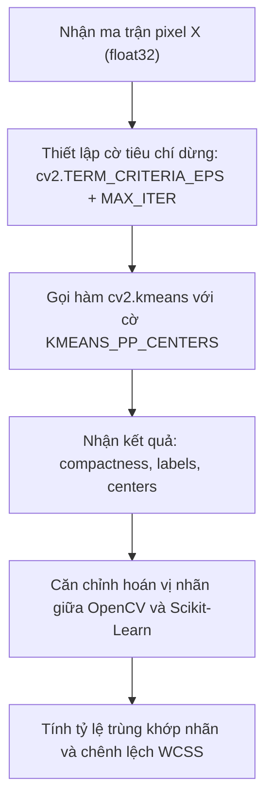

# Thiết kế thuật toán: Phân đoạn màu bằng OpenCV K-Means (Kiểm tra chéo)

---

## 1. Mục đích

- Triển khai yêu cầu **Bước 3: Apply K-Means Clustering** trong đề bài bằng hàm chuyên dụng `cv2.kmeans` tích hợp sẵn trong thư viện thị giác máy tính OpenCV.
- Phục vụ so sánh và kiểm tra chéo cho bài lab:
  - Đo thời gian thực thi của hàm viết bằng C++ trong OpenCV so với các cách khác.
  - So sánh độ tương đồng về kết quả giữa OpenCV và Scikit-Learn: tỷ lệ trùng khớp nhãn pixel (Label Agreement %) và độ chênh lệch quán tính (Inertia vs Compactness).
  - Giúp nhóm hiểu cách một thư viện xử lý ảnh thực hiện thuật toán K-Means trực tiếp trên ma trận pixel.

---

## 2. Trạng thái thiết kế (Status)

- **Trạng thái:** `Bản thiết kế ban đầu (Pending Implementation)`
- **Tiến độ code:** Đã có khung lớp `OpenCVKMeansTrainer` trong `src/models/kmeans_opencv.py`, các hàm còn để trống (`pass`), chưa thực hiện kiểm tra chéo thực tế.

---

## 3. Dữ liệu sử dụng (Data used)

- **Dữ liệu:** Ma trận điểm ảnh `(N, 3)` từ bước tiền xử lý ảnh.
- **Yêu cầu riêng của OpenCV:**
  - OpenCV bắt buộc dữ liệu đầu vào của hàm `cv2.kmeans` phải có kiểu số thực `np.float32` liên tục trong bộ nhớ.
  - Thang giá trị màu vẫn giữ nguyên đoạn `[0.0, 255.0]`.

---

## 4. Đầu vào (Input)

Hàm huấn luyện của OpenCV cần các tham số:

| Tham số     | Kiểu dữ liệu | Ý nghĩa                                                                                                                            | Giá trị dự kiến            |
| :----------- | :-------------- | :----------------------------------------------------------------------------------------------------------------------------------- | :----------------------------- |
| `X`        | `np.ndarray`  | Ma trận điểm ảnh cần phân cụm `(N, 3)`, kiểu `float32`.                                                                  | Lấy từ ảnh sau resize       |
| `k`        | `int`         | Số lượng cụm màu cần gom (dùng cùng giá trị $K$ với bên Scikit-Learn để so sánh).                                   | $K = 4$ hoặc $5$          |
| `attempts` | `int`         | Số lần chạy lại với các tâm khởi tạo khác nhau để chọn lần kết quả tốt nhất (tương tự `n_init` của sklearn). | 10 lần                        |
| `max_iter` | `int`         | Số vòng lặp tối đa.                                                                                                             | 300 vòng                      |
| `epsilon`  | `float`       | Ngưỡng sai số dừng hội tụ theo chuẩn của OpenCV.                                                                             | 1.0 (trên thang RGB [0, 255]) |

---

## 5. Đầu ra (Output)

Hàm `cv2.kmeans` sẽ trả về trực tiếp một tuple gồm 3 giá trị:

- **`compactness` (Độ nén):** Số thực biểu thị tổng bình phương khoảng cách từ các pixel đến tâm cụm của nó. Giá trị này về mặt toán học chính là quán tính WCSS / Inertia.
- **`labels` (Nhãn cụm):** Mảng nhãn 1 chiều kích thước `(N,)`, mỗi phần tử là số nguyên từ $0$ đến $K-1$. (Lưu ý: hàm gốc của OpenCV trả về mảng 2 chiều `(N, 1)` nên cần làm phẳng thành mảng 1 chiều để đồng bộ với các phần khác).
- **`centers` (Tâm cụm màu):** Mảng kích thước `(K, 3)`, lưu màu RGB của các tâm cụm tìm được.
- **Báo cáo đối chiếu (`comparison_report`):** Một bảng hoặc từ điển tóm tắt kết quả so sánh với Scikit-Learn (độ chênh lệch WCSS %, tỷ lệ trùng nhãn %).

---

## 6. Cách thuật toán hoạt động (How it works)



### Bước 1: Thiết lập tiêu chuẩn dừng cho OpenCV

Trong OpenCV, điều kiện dừng được gộp chung bằng một tuple `criteria`:
- Cờ kết hợp: `cv2.TERM_CRITERIA_EPS + cv2.TERM_CRITERIA_MAX_ITER`
- Số vòng lặp tối đa: `max_iter`
- Ngưỡng hội tụ: $\epsilon$ (`epsilon`)

Nghĩa là thuật toán sẽ dừng nếu số vòng lặp chạm tới `max_iter` HOẶC độ dịch chuyển tâm nhỏ hơn $\epsilon$.

### Bước 2: Chạy phân cụm bằng `cv2.kmeans`

Gọi hàm với cờ `cv2.KMEANS_PP_CENTERS` (khởi tạo tâm theo kiểu k-means++ giống Scikit-Learn):
```python
compactness, labels, centers = cv2.kmeans(
    data=X,
    K=k,
    bestLabels=None,
    criteria=criteria,
    attempts=attempts,
    flags=cv2.KMEANS_PP_CENTERS
)
```

### Bước 3: Thuật toán đối chiếu với Scikit-Learn (`compare_with_sklearn`)

1. **So sánh quán tính:**
   Tính độ chênh lệch tương đối giữa quán tính của Scikit-Learn và độ nén của OpenCV:

$$
\Delta_{\text{WCSS}} = \frac{|\text{Inertia}_{\text{sklearn}} - \text{Compactness}_{\text{opencv}}|}{\text{Inertia}_{\text{sklearn}}} \times 100\,\%
$$

2. **Căn chỉnh nhãn (Label Alignment):**
   Hai thư viện có thể đặt tên nhãn cụm khác nhau (ví dụ: cụm màu đỏ bên Scikit-Learn là nhãn $0$, nhưng bên OpenCV lại là nhãn $2$). Đây chỉ là cách đánh số, bản chất gom cụm không thay đổi.
   Trước khi so sánh tỷ lệ trùng khớp nhãn, cần dùng ma trận nhầm lẫn (Confusion Matrix) hoặc thuật toán gán Hungary để ghép cặp nhãn tương ứng giữa 2 bên.

3. **Tính tỷ lệ trùng khớp nhãn (Label Agreement):**
   Sau khi đã hoán vị nhãn cho khớp, đếm số pixel có nhãn giống hệt nhau giữa 2 thư viện chia cho tổng số $N$ pixel.

---

## 7. Cách đánh giá kết quả (Metrics evaluation)

- **Độ chênh lệch quán tính:** Kỳ vọng chênh lệch giữa hai thư viện rất nhỏ (dưới 1%), vì cùng là thuật toán K-Means bám theo tiêu chí tối thiểu hóa WCSS.
- **Tỷ lệ trùng khớp nhãn:** Quan sát xem tỷ lệ trùng khớp có cao không. Nếu đạt trên 90% nghĩa là cả hai thư viện đều phân đoạn ra các mảng màu gần như y hệt nhau.
- **Thời gian thực thi:** Đo thời gian chạy của hàm C++ trong OpenCV so với Python thuần để đưa vào phần nhận xét của báo cáo bài lab.

---

## 8. Mấy điểm dễ lỗi cần chú ý (Lưu ý khi làm)

- **Shape của mảng nhãn:** Mặc định OpenCV trả về mảng nhãn có kích thước `(N, 1)` thay vì `(N,)`. Nếu không làm phẳng bằng `.flatten()`, khi đưa sang hàm tạo ảnh của nhóm sẽ bị lỗi lệch chiều ma trận.
- **Màu sắc BGR và RGB:** OpenCV đọc ảnh mặc định bằng hệ màu BGR. Nhóm phải chắc chắn ma trận điểm ảnh truyền vào hàm này đã được đổi sang RGB ở bước tiền xử lý, tránh việc tâm cụm ra màu ngược (ví dụ đỏ thành xanh).
- **Ý nghĩa của việc so sánh nhãn:** Cần giải thích rõ cho giảng viên hiểu là số thứ tự cụm chỉ là quy ước ngẫu nhiên, không được lấy nhãn của OpenCV trừ trực tiếp cho nhãn Scikit-Learn mà bắt buộc phải căn chỉnh hoán vị trước.

---

## 9. Cách nối với các file khác trong bài (Tính logic hệ thống)

- **Nhận dữ liệu từ đâu:** Nhận ma trận `pixel_matrix` từ `src/data/preprocessing.py`.
- **Cung cấp dữ liệu cho ai:**
  - Trả kết quả nhãn và tâm cho `src/segmentation/segmenter.py` để thử dựng ảnh phân đoạn bằng OpenCV.
  - Trả bảng so sánh chỉ số sang `src/evaluation/visualization.py` và lưu số liệu vào báo cáo tổng kết.
- **File code sẽ viết:** `src/models/kmeans_opencv.py`.
- **File test kiểm tra:** `tests/test_models.py` (kiểm tra hàm căn chỉnh hoán vị nhãn trên mảng giả lập nhỏ).

---

## 10. Phân công trong nhóm

- **Người phụ trách:** Tường & Trí (phối hợp kiểm thử).
- **Nhiệm vụ:** Viết các hàm trong `src/models/kmeans_opencv.py`, thực hiện chạy thử nghiệm so sánh và ghi lại nhận xét đối đầu giữa hai thư viện.
