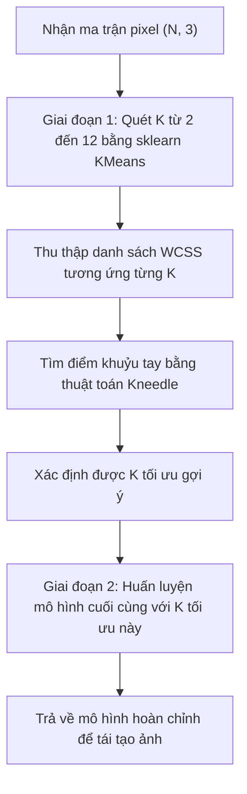

# Thiết kế thuật toán: K-Means bằng Scikit-Learn & Dò tìm số cụm K bằng Elbow

---

## 1. Mục đích

- Triển khai yêu cầu **Bước 3: Apply K-Means Clustering** trong đề bài bằng thư viện chuẩn `sklearn.cluster.KMeans`:
  - Thực hiện phân cụm màu nhanh chóng, tin cậy với thuật toán khởi tạo tối ưu `k-means++`.
  - Có kết quả chuẩn mực để đối chiếu với cách tự code 4 bước bằng NumPy.
- Khảo sát số cụm $K$ (từ $2$ đến $12$) và vẽ đường cong quán tính WCSS theo $K$ (phương pháp Elbow / khuỷu tay).
- Áp dụng thuật toán hình học Kneedle để tự động tìm điểm gập khuỷu tay trên đồ thị, hỗ trợ chọn $K$ trực quan cho bài lab.

---

## 2. Trạng thái thiết kế (Status)

- **Trạng thái:** `Bản thiết kế ban đầu (Pending Implementation)`
- **Tiến độ code:** Đã có khung lớp `SklearnKMeansTrainer` trong file `src/models/kmeans_sklearn.py`, các hàm còn để trống (`pass`), chưa chạy quét K thật trên ảnh.

---

## 3. Dữ liệu sử dụng (Data used)

- **Dữ liệu:** Dùng chung ma trận điểm ảnh `(N, 3)` kiểu `float32` trong đoạn `[0.0, 255.0]` nhận từ bước tiền xử lý ảnh (`src/data/preprocessing.py`).
- **Lý do dùng chung:** Để đảm bảo việc so sánh giữa thuật toán tự viết và thuật toán của thư viện là công bằng (cùng một ảnh, cùng kích thước resize, cùng một ma trận màu).

---

## 4. Đầu vào (Input)

Thuật toán của Scikit-Learn và hàm quét Elbow nhận các tham số:

| Tham số         | Kiểu dữ liệu | Ý nghĩa                                                                                                     | Giá trị dự kiến                        |
| :--------------- | :-------------- | :------------------------------------------------------------------------------------------------------------ | :----------------------------------------- |
| `X`            | `np.ndarray`  | Ma trận điểm ảnh cần phân cụm, kích thước `(N, 3)`.                                               | Từ ảnh sau resize                        |
| `k_range`      | `range`       | Khoảng giá trị $K$ cần quét thử để vẽ biểu đồ Elbow.                                            | `range(2, 13)` (từ 2 đến 12)          |
| `n_init`       | `int`         | Số lần thuật toán chạy lại với các tâm khởi tạo khác nhau để chọn ra lần có WCSS nhỏ nhất. | 10 lần (theo mặc định của thư viện) |
| `max_iter`     | `int`         | Số vòng lặp tối đa cho mỗi lần chạy.                                                                  | 300 vòng                                  |
| `random_state` | `int`         | Seed ngẫu nhiên cố định để kết quả chạy không đổi giữa các lần thử.                          | 42                                         |

---

## 5. Đầu ra (Output)

- **Bảng dữ liệu quét Elbow (`df_elbow`):** Bảng gồm 2 cột:
  - Cột `K`: Giá trị số cụm thử nghiệm (2, 3, 4, ..., 12).
  - Cột `Inertia`: Giá trị WCSS tương ứng với từng $K$.
- **`optimal_k` (Số cụm tối ưu gợi ý):** Một số nguyên do thuật toán Kneedle tìm ra tại điểm gập của đồ thị (ví dụ dự kiến quanh mức 4 hoặc 5 tùy ảnh).
- **Mô hình hoàn chỉnh (`final_model`):** Đối tượng `KMeans` của Scikit-Learn đã được huấn luyện xong với $K = K_{\text{optimal}}$, chứa:
  - `cluster_centers_`: Tọa độ tâm cụm màu `(K, 3)`.
  - `labels_`: Nhãn cụm của từng điểm ảnh `(N,)`.
  - `inertia_`: Giá trị quán tính cuối cùng.

---

## 6. Cách thuật toán hoạt động (How it works)

Quá trình xử lý gồm 2 giai đoạn chính:

### Giai đoạn 1: Quét Elbow và tìm K tối ưu (`search_elbow` & `find_knee_point`)

1. Lặp qua từng giá trị $K$ trong khoảng từ $2$ đến $12$.
2. Với mỗi $K$, gọi `KMeans(n_clusters=K, init='k-means++', n_init=10, random_state=42)` và huấn luyện trên `X`.
3. Lấy giá trị quán tính `model.inertia_` lưu vào danh sách.
4. Tự động tìm điểm khuỷu tay (Elbow) bằng nguyên lý hình học Kneedle:
   - Chuẩn hóa cả trục $K$ và trục WCSS về đoạn $[0, 1]$.
   - Kẻ một đường thẳng nối điểm đầu $(K_{\min}, \text{WCSS}_{\max})$ và điểm cuối $(K_{\max}, \text{WCSS}_{\min})$.
   - Với mỗi điểm trên đường cong thực tế, tính khoảng cách vuông góc từ điểm đó tới đường thẳng nối.
   - Điểm nào có khoảng cách vuông góc xa nhất chính là điểm khuỷu tay (nơi tốc độ giảm của WCSS bắt đầu chậm lại rõ rệt). Điểm này được chọn làm `optimal_k`.

### Giai đoạn 2: Huấn luyện mô hình cuối cùng (`fit_final_model`)

1. Dùng giá trị `optimal_k` ($K_{\text{optimal}}$) vừa tìm được để khởi tạo mô hình cuối cùng.
2. Gọi `fit(X)` để học các tâm màu đại diện tốt nhất cho ảnh.
3. Xuất ra bộ nhãn và tâm màu phục vụ tái tạo ảnh.

---

## 7. Cách đánh giá kết quả (Metrics evaluation)

1. **Độ dốc của đường cong WCSS:**
   - Khi tăng $K$, WCSS luôn luôn giảm. Nhóm cần kiểm tra xem đường cong có đúng hình dạng dốc đứng lúc đầu rồi thoai thoải về sau hay không.
2. **Quan sát trực quan theo từng K:**
   - Thử nhìn ảnh tái tạo ở một vài giá trị $K$ khác nhau (ví dụ $K=3, 5, 8$) xem $K$ nào cho ra ảnh vừa đủ rõ các vùng màu mà không bị thừa thãi quá nhiều mảng màu vụn vặt.
3. **Đối chiếu với code tự viết:**
   - So sánh giá trị WCSS của Scikit-Learn với WCSS của file `kmeans_from_scratch.py` ở cùng một $K$ để kiểm tra xem thuật toán nhóm tự viết có tiệm cận với thư viện chuẩn hay không.

---

## 8. Mấy điểm dễ lỗi cần chú ý (Lưu ý khi làm)

- **Điểm Elbow không phải lúc nào cũng rõ:** Trên dữ liệu ảnh thực tế ngoài đời, màu sắc biến thiên liên tục, đường cong WCSS có thể giảm rất đều mà không có một điểm gập rõ mồn một. Khi đó thuật toán Kneedle vẫn sẽ tìm ra một điểm xa nhất theo toán học, nhưng nhóm phải tự kiểm tra lại bằng mắt xem ảnh có hợp lý không, không nên phó mặc hoàn toàn cho thuật toán.
- **Thời gian chạy quét K:** Vì phải chạy K-Means tới 11 lần (từ $K=2$ đến $K=12$), mỗi lần lại chạy 10 lượt `n_init`, nên tổng cộng phải lặp 110 lượt. Nếu dùng ảnh gốc quá to sẽ bị đơ máy. Bắt buộc phải chạy trên ảnh đã resize nhỏ ở bước tiền xử lý.
- **Thư viện phụ trợ:** Thuật toán Kneedle có thể dùng thư viện `kneed`, nhưng để đề phòng máy của thầy hoặc máy các bạn trong nhóm chưa cài thư viện này, file `kmeans_sklearn.py` sẽ viết sẵn một đoạn code hình học thuần bằng NumPy để tự tính mà không cần cài thêm gói ngoài.

---
