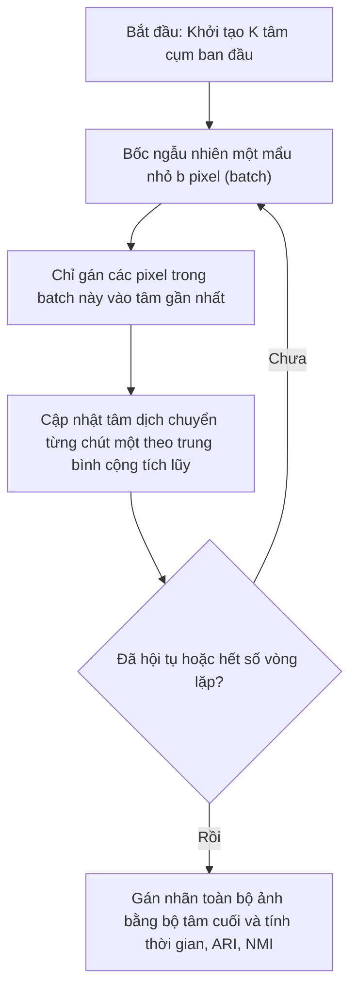

# Thiết kế thuật toán: Thử nghiệm tốc độ với Mini-Batch K-Means

---

## 1. Mục đích

- Tìm hiểu cách thuật toán Mini-Batch K-Means giải quyết bài toán thời gian khi số lượng điểm ảnh $N$ tăng lớn.
- Khảo sát sự đánh đổi (trade-off) trong bài lab:
  - MiniBatch có giúp thời gian chạy nhanh hơn K-Means thông thường (Full K-Means) không? Tăng tốc được bao nhiêu lần?
  - Bù lại, chất lượng gom cụm màu có bị giảm đi nhiều không (quán tính WCSS có bị tăng lên không, màu sắc ảnh phân đoạn nhìn bằng mắt có bị bệt hoặc sai khác nhiều không)?
  - Đo độ tương đồng giữa hai cách gom cụm thông qua các chỉ số thống kê như Adjusted Rand Index (ARI) và Normalized Mutual Information (NMI).

---

## 2. Trạng thái thiết kế (Status)

- **Trạng thái:** `Bản thiết kế ban đầu (Pending Implementation)`
- **Tiến độ code:** Đã có khung lớp `MiniBatchKMeansTrainer` trong `src/models/minibatch_kmeans.py`, các hàm còn để trống (`pass`), chưa chạy thử nghiệm trên các kích thước batch khác nhau.

---

## 3. Dữ liệu sử dụng (Data used)

- **Dữ liệu:** Ma trận điểm ảnh `(N, 3)` từ bước tiền xử lý ảnh, kiểu `float32`, miền giá trị màu `[0.0, 255.0]`.
- Thử nghiệm trên cùng một ảnh và cùng số cụm $K$ để kết quả so sánh thời gian và chất lượng là khách quan.

---

## 4. Đầu vào (Input)

Thuật toán thử nghiệm Mini-Batch cần nhận các tham số:

| Tham số              | Kiểu dữ liệu | Ý nghĩa                                                                         | Giá trị dự kiến thử nghiệm    |
| :-------------------- | :-------------- | :-------------------------------------------------------------------------------- | :---------------------------------- |
| `X`                 | `np.ndarray`  | Ma trận điểm ảnh cần phân cụm `(N, 3)`.                                  | Dữ liệu ảnh thực tế            |
| `k`                 | `int`         | Số lượng cụm màu (chọn cố định một số, ví dụ $K=5$).               | $K = 5$                           |
| `batch_sizes`       | `List[int]`   | Danh sách các kích thước mẩu dữ liệu nhỏ (batch) cần thử.              | `[256, 512, 1024, 2048, 4096]`    |
| `full_kmeans_model` | `KMeans`      | Mô hình Full K-Means đã chạy trước đó để làm mốc chuẩn so sánh.    | Mô hình từ `kmeans_sklearn.py` |
| `random_state`      | `int`         | Seed ngẫu nhiên để việc bốc ngẫu nhiên từng batch không bị trồi sụt. | 42                                  |

---

## 5. Đầu ra (Output)

- **Bảng kết quả so sánh (`df_comparison`):** Một bảng dữ liệu ghi nhận chi tiết theo từng `batch_size`:
  - `batch_size`: Kích thước lô thử nghiệm.
  - `training_time`: Thời gian chạy thực tế (tính bằng mili-giây hoặc giây).
  - `speedup`: Tỷ lệ tăng tốc so với Full K-Means (ví dụ nhanh hơn 2x, 3x).
  - `inertia`: Quán tính WCSS của Mini-Batch.
  - `inertia_increase_%`: Tỷ lệ WCSS bị tăng lên so với mốc chuẩn (chất lượng bị giảm bao nhiêu %).
  - `ari`: Chỉ số Adjusted Rand Index đo mức độ đồng thuận nhãn (thang đo từ 0 đến 1).
  - `nmi`: Chỉ số Normalized Mutual Information (đo thông tin tương hỗ giữa 2 cách chia cụm).

---

## 6. Cách thuật toán hoạt động (How it works)

Thay vì mỗi vòng lặp phải lôi toàn bộ $N$ điểm ảnh ra để tính khoảng cách và cộng trung bình như K-Means truyền thống, Mini-Batch K-Means làm như sau:

### Các bước chi tiết trong thử nghiệm (`compare_batch_sizes`)

1. **Lấy mốc chuẩn:**
   - Lấy thời gian chạy và quán tính WCSS của mô hình `Full K-Means` làm mốc gốc ($t_{full}, WCSS_{full}$).
2. **Quét qua từng kích thước `batch_size`:**
   - Khởi tạo `MiniBatchKMeans(n_clusters=k, batch_size=b, random_state=42)`.
   - Bấm giờ trước và sau khi gọi `fit(X)` để đo thời gian huấn luyện $t_{batch}$.
   - Tính hệ số tăng tốc: $\text{Speedup} = \frac{t_{full}}{t_{batch}}$.
   - Lấy giá trị WCSS và tính tỷ lệ quán tính bị tăng:

$$
\Delta_{\text{WCSS}} = \frac{\text{WCSS}_{\text{batch}} - \text{WCSS}_{\text{full}}}{\text{WCSS}_{\text{full}}} \times 100\,\%
$$

   - Tính chỉ số `adjusted_rand_score` và `normalized_mutual_info_score` giữa nhãn của Mini-Batch và nhãn của Full K-Means để xem hai cách có chia các vùng màu tương tự nhau không.
3. **Tổng hợp báo cáo:** Gom toàn bộ vào một bảng dữ liệu rõ ràng.

---

## 7. Cách đánh giá kết quả (Metrics evaluation)

- **Hệ số tăng tốc (Speedup factor):** Xem ở kích thước batch nào thì thuật toán chạy nhanh nhất mà không làm giảm chất lượng.
- **Mức độ suy giảm chất lượng ($\Delta_{\text{WCSS}}$):** Kỳ vọng WCSS của Mini-Batch chỉ tăng nhẹ (dưới 3-5%) so với Full K-Means.
- **Chỉ số tương đồng ARI và NMI:**
  - Nếu $ARI > 0.85$ và $NMI > 0.85$, nghĩa là cách phân đoạn của Mini-Batch gần như tương đương với cách chạy chuẩn.
- **Cảm quan mắt nhìn:** Xem ảnh phân đoạn tạo bởi Mini-Batch có xuất hiện các đốm hạt màu lạ (nhiễu) so với ảnh Full K-Means hay không.

---

## 8. Mấy điểm dễ lỗi cần chú ý (Lưu ý khi làm)

- **Kích thước batch quá nhỏ:** Nếu chọn `batch_size` quá nhỏ (ví dụ vài chục pixel), mẫu bốc ngẫu nhiên sẽ không đại diện đủ các mảng màu trên ảnh, làm tâm cụm bị giật cục và ảnh ra màu rất xấu.
- **Ảnh kích thước nhỏ:** Nếu ảnh của bài lab đã được resize xuống khá nhỏ (ví dụ $128 \times 128 = 16.384$ pixel), Full K-Means vốn đã chạy rất nhanh (dưới 1 giây). Khi đó, Mini-Batch có thể không thấy rõ ưu thế tăng tốc do chi phí quản lý các mẩu nhỏ (overhead). Nhóm cần giải thích rõ điểm này trong phần báo cáo.
- **Ý nghĩa của ARI và NMI:** Cần nhớ rằng ARI và NMI ở đây chỉ là so sánh giữa Mini-Batch với Full K-Means, chứ không phải so với "đáp án chuẩn của mắt người" (Ground Truth) vì bài này không có nhãn ground truth.
